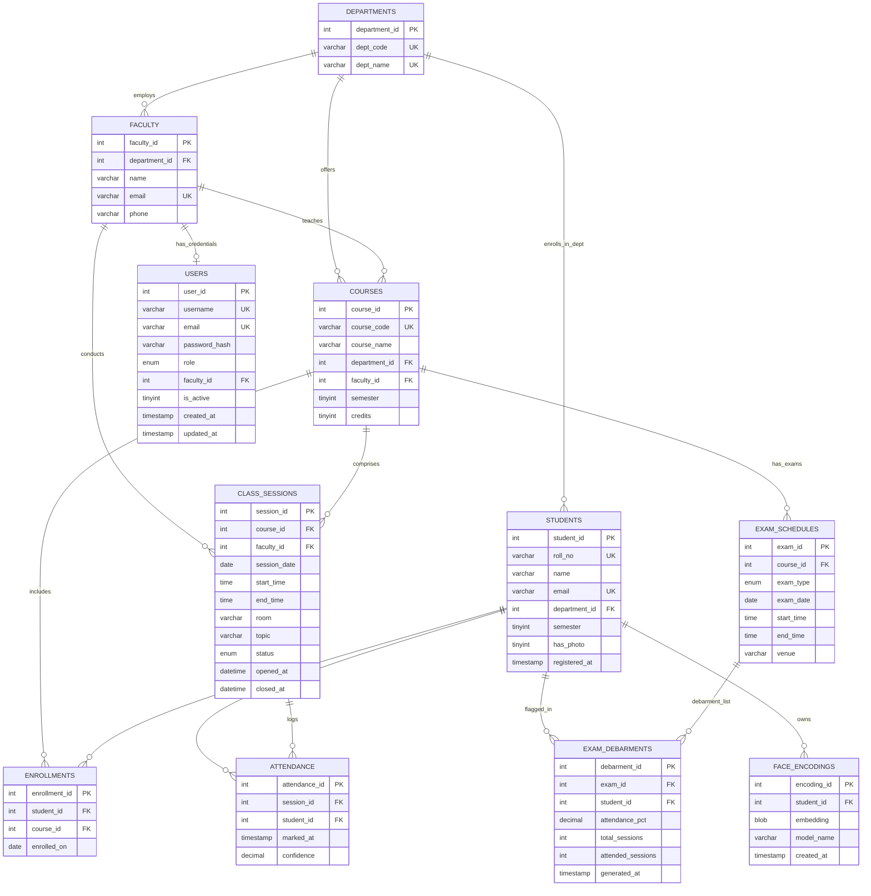

# Database Design Document: Smart Attendance Management System

## 1. Overview & Architectural Principles

The database design for the **Smart Attendance Management System** is engineered to provide strict ACID compliance, data integrity, biometrics storage, and automated attendance analysis for academic institutions.

### Summary Statistics
- **Total Tables:** 11 application tables + 1 migration tracking table
- **Primary Entities:** Department, Faculty, Course, Student, ClassSession, ExamSchedule, User (7 Primary Entities)
- **Relationships:** Over 8 declarative foreign-key relationships including 1:Many, Many:Many, and self/cross-entity associations.
- **Integrity Enforcement:** Primary keys on all tables, Foreign keys with `ON DELETE CASCADE` / `SET NULL` / `RESTRICT`, Unique constraints on business keys (roll numbers, emails, course codes, session pairings), and domain `CHECK` constraints on semesters, time spans, roles, and status flags.

---

## 2. Entity-Relationship (ER) Diagram

The following Mermaid diagram models the exact schema deployed in the MySQL database:

---

## 3. Relational Schema Specification

Formal Relational Database notation (Primary Keys underlined, Foreign Keys italicized):

1. **`DEPARTMENTS`** (<u>`department_id`</u>, `dept_code`, `dept_name`)
   - Unique Keys: `dept_code`, `dept_name`

2. **`FACULTY`** (<u>`faculty_id`</u>, *`department_id`*, `name`, `email`, `phone`)
   - Foreign Key: `department_id` REFERENCES `DEPARTMENTS(department_id)` ON UPDATE CASCADE ON DELETE RESTRICT
   - Unique Key: `email`

3. **`COURSES`** (<u>`course_id`</u>, `course_code`, `course_name`, *`department_id`*, *`faculty_id`*, `semester`, `credits`)
   - Foreign Key: `department_id` REFERENCES `DEPARTMENTS(department_id)` ON UPDATE CASCADE ON DELETE RESTRICT
   - Foreign Key: `faculty_id` REFERENCES `FACULTY(faculty_id)` ON UPDATE CASCADE ON DELETE SET NULL
   - Unique Key: `course_code`
   - Check Constraint: `semester BETWEEN 1 AND 12`

4. **`STUDENTS`** (<u>`student_id`</u>, `roll_no`, `name`, `email`, *`department_id`*, `semester`, `has_photo`, `registered_at`)
   - Foreign Key: `department_id` REFERENCES `DEPARTMENTS(department_id)` ON UPDATE CASCADE ON DELETE RESTRICT
   - Unique Keys: `roll_no`, `email`
   - Check Constraint: `semester BETWEEN 1 AND 12`

5. **`FACE_ENCODINGS`** (<u>`encoding_id`</u>, *`student_id`*, `embedding`, `model_name`, `created_at`)
   - Foreign Key: `student_id` REFERENCES `STUDENTS(student_id)` ON DELETE CASCADE

6. **`ENROLLMENTS`** (<u>`enrollment_id`</u>, *`student_id`*, *`course_id`*, `enrolled_on`)
   - Foreign Key: `student_id` REFERENCES `STUDENTS(student_id)` ON DELETE CASCADE
   - Foreign Key: `course_id` REFERENCES `COURSES(course_id)` ON DELETE CASCADE
   - Unique Key: (`student_id`, `course_id`)

7. **`CLASS_SESSIONS`** (<u>`session_id`</u>, *`course_id`*, *`faculty_id`*, `session_date`, `start_time`, `end_time`, `room`, `topic`, `status`, `opened_at`, `closed_at`)
   - Foreign Key: `course_id` REFERENCES `COURSES(course_id)` ON DELETE CASCADE
   - Foreign Key: `faculty_id` REFERENCES `FACULTY(faculty_id)` ON DELETE SET NULL
   - Check Constraint: `end_time > start_time`

8. **`ATTENDANCE`** (<u>`attendance_id`</u>, *`session_id`*, *`student_id`*, `marked_at`, `confidence`)
   - Foreign Key: `session_id` REFERENCES `CLASS_SESSIONS(session_id)` ON DELETE CASCADE
   - Foreign Key: `student_id` REFERENCES `STUDENTS(student_id)` ON DELETE CASCADE
   - Unique Key: (`session_id`, `student_id`)

9. **`EXAM_SCHEDULES`** (<u>`exam_id`</u>, *`course_id`*, `exam_type`, `exam_date`, `start_time`, `end_time`, `venue`)
   - Foreign Key: `course_id` REFERENCES `COURSES(course_id)` ON DELETE CASCADE
   - Check Constraint: `end_time > start_time`

10. **`EXAM_DEBARMENTS`** (<u>`debarment_id`</u>, *`exam_id`*, *`student_id`*, `attendance_pct`, `total_sessions`, `attended_sessions`, `generated_at`)
    - Foreign Key: `exam_id` REFERENCES `EXAM_SCHEDULES(exam_id)` ON DELETE CASCADE
    - Foreign Key: `student_id` REFERENCES `STUDENTS(student_id)` ON DELETE CASCADE
    - Unique Key: (`exam_id`, `student_id`)

11. **`USERS`** (<u>`user_id`</u>, `username`, `email`, `password_hash`, `role`, *`faculty_id`*, `is_active`, `created_at`, `updated_at`)
    - Foreign Key: `faculty_id` REFERENCES `FACULTY(faculty_id)` ON DELETE SET NULL ON UPDATE CASCADE
    - Unique Keys: `username`, `email`
    - Check Constraints: `role IN ('Admin', 'Faculty')`, `is_active IN (0, 1)`

---

## 4. Normalization Analysis (1NF through BCNF)

The schema was designed methodically to eliminate insert, update, and deletion anomalies.

### First Normal Form (1NF) Compliance
- **Rule:** Every attribute contains only atomic (indivisible) values; no repeating groups or arrays exist.
- **Proof:** 
  - All attributes represent single values (e.g., student name is a single scalar string; dates, timestamps, numbers are atomic).
  - Multi-valued attributes (such as multiple photos/face encodings for a student, or multiple course enrollments) are factored out into dedicated child entities (`face_encodings`, `enrollments`).
  - Attendance records store exactly one verified capture event per student session.
  - Hence, all tables satisfy **1NF**.

### Second Normal Form (2NF) Compliance
- **Rule:** The relation is in 1NF and every non-prime attribute is fully functionally dependent on the entire primary key (no partial functional dependencies on composite keys).
- **Proof:**
  - In tables with single-column surrogate primary keys (`departments`, `faculty`, `courses`, `students`, `face_encodings`, `class_sessions`, `attendance`, `exam_schedules`, `exam_debarments`, `users`), partial dependencies are mathematically impossible because the primary key cannot be decomposed.
  - In associative tables with unique composite candidate keys, such as `enrollments(student_id, course_id)`:
    - Non-key attribute `enrolled_on` depends on the combination of both student and course, not on either individually ($(\text{student\_id}, \text{course\_id}) \rightarrow \text{enrolled\_on}$).
  - In `attendance(session_id, student_id)`:
    - Non-key attributes `marked_at` and `confidence` describe the specific attendance event occurring for that student during that exact session ($(\text{session\_id}, \text{student\_id}) \rightarrow (\text{marked\_at}, \text{confidence})$).
  - Hence, all tables satisfy **2NF**.

### Third Normal Form (3NF) Compliance
- **Rule:** The relation is in 2NF and there are no transitive dependencies ($X \rightarrow Y$ and $Y \rightarrow Z$ where $Z$ is non-prime and depends on non-key $Y$). Every non-prime attribute must depend *only* on candidate keys.
- **Proof:**
  - In `students`, demographic data depends solely on `student_id` (or candidate key `roll_no`). Department details (`dept_name`) are not duplicated in `students`; only the foreign key `department_id` is retained.
  - In `courses`, faculty details (name, email) are not stored directly in `courses`; only `faculty_id` is maintained, eliminating $course\_id \rightarrow faculty\_id \rightarrow faculty\_email$.
  - In `attendance`, student names, roll numbers, and course codes are not stored; they are retrieved via relational joins.
  - In `users`, faculty profile data is not duplicated; only `faculty_id` references the `faculty` table.
  - Hence, all tables satisfy **3NF**.

### Boyce-Codd Normal Form (BCNF) Compliance
- **Rule:** For every non-trivial functional dependency $X \rightarrow Y$, the determinant $X$ must be a superkey.
- **Proof:**
  - In `departments`: Candidate keys are `department_id`, `dept_code`, and `dept_name`. All determinants are candidate keys.
  - In `faculty`: Candidate keys are `faculty_id` and `email`. All determinants are candidate keys.
  - In `courses`: Candidate keys are `course_id` and `course_code`. All determinants are candidate keys.
  - In `students`: Candidate keys are `student_id`, `roll_no`, and `email`. All determinants are candidate keys.
  - In `users`: Candidate keys are `user_id`, `username`, and `email`. All determinants are candidate keys.
  - In `enrollments`: Candidate key is (`student_id`, `course_id`) and surrogate key `enrollment_id`. Both determine all other attributes.
  - In `attendance`: Candidate key is (`session_id`, `student_id`) and surrogate key `attendance_id`. Both determine all other attributes.
  - In `exam_debarments`: Candidate key is (`exam_id`, `student_id`) and surrogate key `debarment_id`.
  - There are no overlapping candidate keys with non-trivial dependencies from a proper subset.
  - Hence, the entire schema strictly conforms to **BCNF**.

---

## 5. Comprehensive Data Dictionary

### Table 1: `departments`
Stores academic divisions/departments within the institution.

| Column | Type | Nullable | Default | Constraints | Description |
| :--- | :--- | :--- | :--- | :--- | :--- |
| `department_id` | INT | NO | AUTO_INCREMENT | PK | Unique surrogate identifier for department |
| `dept_code` | VARCHAR(10) | NO | None | UNIQUE | Short department code (e.g., 'CSE', 'ECE') |
| `dept_name` | VARCHAR(100) | NO | None | UNIQUE | Full official department title |

---

### Table 2: `faculty`
Stores academic professors and instructors.

| Column | Type | Nullable | Default | Constraints | Description |
| :--- | :--- | :--- | :--- | :--- | :--- |
| `faculty_id` | INT | NO | AUTO_INCREMENT | PK | Unique surrogate identifier for faculty |
| `department_id` | INT | NO | None | FK -> departments | Department where faculty belongs |
| `name` | VARCHAR(100) | NO | None | | Full official name with academic title |
| `email` | VARCHAR(120) | NO | None | UNIQUE | Institutional email address |
| `phone` | VARCHAR(20) | YES | NULL | | Contact phone number |

---

### Table 3: `courses`
Stores curriculum course definitions taught within departments.

| Column | Type | Nullable | Default | Constraints | Description |
| :--- | :--- | :--- | :--- | :--- | :--- |
| `course_id` | INT | NO | AUTO_INCREMENT | PK | Unique surrogate identifier for course |
| `course_code` | VARCHAR(20) | NO | None | UNIQUE | Official course catalog code (e.g. 'CS301') |
| `course_name` | VARCHAR(120) | NO | None | | Full course title |
| `department_id` | INT | NO | None | FK -> departments | Offering department |
| `faculty_id` | INT | YES | NULL | FK -> faculty | Primary assigned faculty instructor |
| `semester` | TINYINT | NO | None | CHECK (1..12) | Academic semester number |
| `credits` | TINYINT | NO | 3 | | Academic credit hours |

---

### Table 4: `students`
Stores registered university students.

| Column | Type | Nullable | Default | Constraints | Description |
| :--- | :--- | :--- | :--- | :--- | :--- |
| `student_id` | INT | NO | AUTO_INCREMENT | PK | Unique surrogate identifier for student |
| `roll_no` | VARCHAR(30) | NO | None | UNIQUE | Official university registration number |
| `name` | VARCHAR(100) | NO | None | | Student's full legal name |
| `email` | VARCHAR(120) | YES | NULL | UNIQUE | Student's institutional email |
| `department_id` | INT | NO | None | FK -> departments | Major/enrolled department |
| `semester` | TINYINT | NO | None | CHECK (1..12) | Current enrolled semester |
| `has_photo` | TINYINT(1) | NO | 0 | | Flag: 1 if face thumbnails are saved |
| `registered_at` | TIMESTAMP | NO | CURRENT_TIMESTAMP | | Timestamp when student was enrolled |

---

### Table 5: `face_encodings`
Stores deep neural network face biometric vectors for student recognition.

| Column | Type | Nullable | Default | Constraints | Description |
| :--- | :--- | :--- | :--- | :--- | :--- |
| `encoding_id` | INT | NO | AUTO_INCREMENT | PK | Unique encoding identifier |
| `student_id` | INT | NO | None | FK -> students (CASCADE) | Student owner of this face vector |
| `embedding` | BLOB | NO | None | | 128-D float32 vector (512 bytes) |
| `model_name` | VARCHAR(40) | NO | 'SFace-2021dec' | | Face model identifier |
| `created_at` | TIMESTAMP | NO | CURRENT_TIMESTAMP | | Vector generation timestamp |

---

### Table 6: `enrollments`
Models the Many-to-Many relationship between students and courses.

| Column | Type | Nullable | Default | Constraints | Description |
| :--- | :--- | :--- | :--- | :--- | :--- |
| `enrollment_id` | INT | NO | AUTO_INCREMENT | PK | Unique enrollment record ID |
| `student_id` | INT | NO | None | FK -> students (CASCADE) | Enrolled student |
| `course_id` | INT | NO | None | FK -> courses (CASCADE) | Course in which student is registered |
| `enrolled_on` | DATE | NO | CURRENT_DATE | | Date enrollment was initiated |

*Unique Key:* (`student_id`, `course_id`) prevents duplicate enrollments.

---

### Table 7: `class_sessions`
Tracks individual scheduled, live, and completed class lecture meetings.

| Column | Type | Nullable | Default | Constraints | Description |
| :--- | :--- | :--- | :--- | :--- | :--- |
| `session_id` | INT | NO | AUTO_INCREMENT | PK | Unique class meeting ID |
| `course_id` | INT | NO | None | FK -> courses (CASCADE) | Course being conducted |
| `faculty_id` | INT | YES | NULL | FK -> faculty (SET NULL) | Conducting instructor |
| `session_date` | DATE | NO | None | | Date lecture is held |
| `start_time` | TIME | NO | None | | Scheduled start time |
| `end_time` | TIME | NO | None | CHECK (end_time > start_time) | Scheduled end time |
| `room` | VARCHAR(30) | YES | NULL | | Lecture hall or lab number |
| `topic` | VARCHAR(150) | YES | NULL | | Subject matter discussed |
| `status` | ENUM | NO | 'Scheduled' | 'Scheduled','Open','Closed' | Lifecycle state machine flag |
| `opened_at` | DATETIME | YES | NULL | | Timestamp session was set to Open |
| `closed_at` | DATETIME | YES | NULL | | Timestamp session was closed |

---

### Table 8: `attendance`
Stores verified attendance markings captured during open class sessions.

| Column | Type | Nullable | Default | Constraints | Description |
| :--- | :--- | :--- | :--- | :--- | :--- |
| `attendance_id` | INT | NO | AUTO_INCREMENT | PK | Unique attendance event ID |
| `session_id` | INT | NO | None | FK -> class_sessions (CASCADE) | Session in which attendance was marked |
| `student_id` | INT | NO | None | FK -> students (CASCADE) | Student verified present |
| `marked_at` | TIMESTAMP | NO | CURRENT_TIMESTAMP | | Exact timestamp of facial confirmation |
| `confidence` | DECIMAL(5,4) | NO | None | | Cosine similarity score (e.g. 0.8524) |

*Unique Key:* (`session_id`, `student_id`) guarantees a student cannot be recorded twice in the same session.

---

### Table 9: `exam_schedules`
Defines institutional evaluation milestones and examinations for courses.

| Column | Type | Nullable | Default | Constraints | Description |
| :--- | :--- | :--- | :--- | :--- | :--- |
| `exam_id` | INT | NO | AUTO_INCREMENT | PK | Unique exam schedule ID |
| `course_id` | INT | NO | None | FK -> courses (CASCADE) | Course examined |
| `exam_type` | ENUM | NO | 'End-Term' | 'Internal','Mid-Term','End-Term','Practical' | Examination category |
| `exam_date` | DATE | NO | None | | Date of examination |
| `start_time` | TIME | NO | None | | Scheduled examination start |
| `end_time` | TIME | NO | None | CHECK (end_time > start_time) | Scheduled examination end |
| `venue` | VARCHAR(60) | YES | NULL | | Examination hall location |

---

### Table 10: `exam_debarments`
Contains automatically computed debarment rosters for students with attendance shortages (<75%).

| Column | Type | Nullable | Default | Constraints | Description |
| :--- | :--- | :--- | :--- | :--- | :--- |
| `debarment_id` | INT | NO | AUTO_INCREMENT | PK | Unique debarment entry ID |
| `exam_id` | INT | NO | None | FK -> exam_schedules (CASCADE) | Exam from which student is debarred |
| `student_id` | INT | NO | None | FK -> students (CASCADE) | Debarred student |
| `attendance_pct`| DECIMAL(6,2) | NO | None | | Student's attendance rate at generation |
| `total_sessions`| INT | NO | None | | Number of classes conducted to date |
| `attended_sessions`| INT | NO | None | | Number of classes attended |
| `generated_at` | TIMESTAMP | NO | CURRENT_TIMESTAMP | | Timestamp when procedure was executed |

*Unique Key:* (`exam_id`, `student_id`) prevents duplicate debarment listings.

---

### Table 11: `users`
Backs authentication and role-based access control (Admin / Faculty).

| Column | Type | Nullable | Default | Constraints | Description |
| :--- | :--- | :--- | :--- | :--- | :--- |
| `user_id` | INT | NO | AUTO_INCREMENT | PK | Unique user account ID |
| `username` | VARCHAR(50) | NO | None | UNIQUE | Login username |
| `email` | VARCHAR(120) | NO | None | UNIQUE | Institutional email |
| `password_hash`| VARCHAR(255) | NO | None | | Secure Werkzeug scrypt hash |
| `role` | ENUM | NO | 'Faculty' | 'Admin','Faculty' (CHECK) | Assigned system authorization role |
| `faculty_id` | INT | YES | NULL | FK -> faculty (SET NULL) | Associated faculty profile for Faculty role |
| `is_active` | TINYINT(1) | NO | 1 | CHECK (0, 1) | Active flag (0 disables login) |
| `created_at` | TIMESTAMP | NO | CURRENT_TIMESTAMP | | Account creation date |
| `updated_at` | TIMESTAMP | NO | CURRENT_TIMESTAMP ON UPDATE | | Last credential update timestamp |
