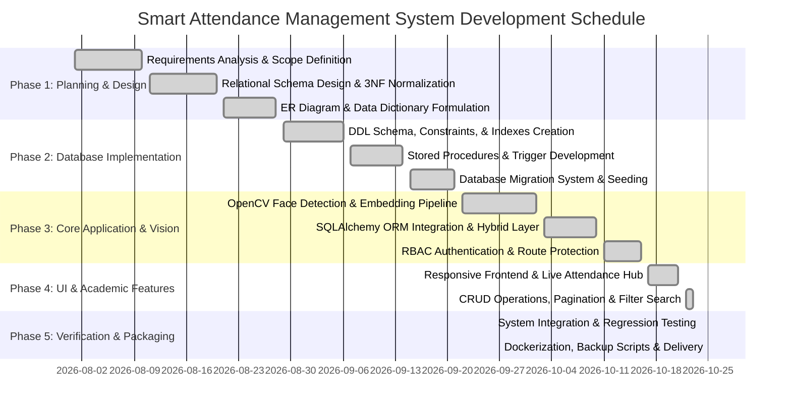

# Project Planning Document: Smart Attendance Management System

## 1. Project Title
**Smart Attendance Management System (SAMS)**  
*An Automated, Biometric Computer-Vision and Relational DBMS Attendance Platform*

---

## 2. Problem Statement
Traditional university attendance tracking systems rely predominantly on manual roll calls or paper-based signature rosters. These legacy practices exhibit severe institutional deficiencies:
1. **Instructional Time Depletion:** Manual attendance consumes 10–15% of instructional lecture time per session.
2. **Proxy Attendance & Impersonation:** Paper rosters and static ID card swipes are easily forged or passed between peers, compromising data integrity.
3. **Delayed Shortage Detection:** Attendance percentages are conventionally aggregated only at the end of the semester, preventing timely academic interventions for students falling below mandatory attendance thresholds (e.g., 75%).
4. **Administrative Overhead & Examination Discrepancies:** Generating manual debarment rosters prior to examinations requires extensive cross-referencing between enrollment records, faculty sheets, and departmental criteria, leading to human error and disputed eligibility.

The **Smart Attendance Management System** resolves these challenges by combining non-intrusive edge facial recognition (OpenCV YuNet and SFace ONNX deep neural networks) with an ACID-compliant, highly normalized relational database management system (MySQL 8.0+ and SQLAlchemy ORM) that automates tracking, real-time threshold calculations, and exam debarment enforcement.

---

## 3. Project Objectives
- **Automated Facial Recognition:** Implement accurate, real-time facial detection and 128-dimensional cosine vector matching in under 200ms per frame.
- **Relational Integrity & Normalization:** Model institutional entities across 11 normalized tables adhering strictly to Third Normal Form (3NF) and Boyce-Codd Normal Form (BCNF), with declarative foreign keys, unique keys, and domain check constraints.
- **Role-Based Access Control (RBAC):** Provide granular security boundaries separating system administrators (full structural and user control) and faculty members (course-scoped operational access).
- **Proactive Academic Governance:** Dynamically calculate shortage statistics via database views, computing exact remedial sessions required to achieve compliance, and automate exam debarment rosters via transactional stored procedures.
- **Dual DBMS Architecture:** Employ a hybrid database access model utilizing SQLAlchemy ORM for object-oriented CRUD validation and raw parameterized MySQL connector sessions for analytical views and high-throughput vector attendance ingestion.

---

## 4. Project Scope

### In-Scope
- **Academic Hierarchy Management:** CRUD operations for Departments, Faculty, Courses, and Semesters.
- **Student Information & Biometrics:** Registration of student demographic records along with multiple facial angle embeddings (128-D float vectors) and thumbnail generation.
- **Automated Enrollment:** Departmental and semester-based bulk course enrollments with individual overrides.
- **Class Session Lifecycle:** State-machine session management (`Scheduled` -> `Open` -> `Closed`) preventing stale or unauthorized attendance recording.
- **Live Attendance Camera Hub:** In-browser video streaming with frame confirmation filters to eliminate accidental passes.
- **Exam Debarment Automation:** Scheduled exam management with real-time recalculation of student eligibility thresholds (<75% debarred).
- **Audit & User Management:** Administrative account lifecycle management, active status toggles, and secure password hashing (`scrypt`).
- **Reporting & Exports:** CSV generation for shortage reports, debarred student lists, and responsive web dashboards.

### Out-of-Scope (Future Enhancements)
- Multi-campus distributed database replication.
- SMS/WhatsApp notification gateway integration (placeholder email alerts configured).
- RFID/NFC secondary factor physical door turnstile hardware integration.

---

## 5. Team Members & Responsibility Matrix

> *Note: Placeholders provided for academic project submission.*

| Role | Responsibility Placeholder | Key Deliverables & Focus Areas |
| :--- | :--- | :--- |
| **Project Lead & Database Architect** | `[Team Member 1 - Name / ID]` | Relational schema design, 3NF normalization, EER modeling, stored procedures, triggers, migrations |
| **Backend & Security Engineer** | `[Team Member 2 - Name / ID]` | Flask application architecture, SQLAlchemy ORM integration, RBAC, password hashing, API design |
| **Computer Vision & ML Specialist** | `[Team Member 3 - Name / ID]` | OpenCV YuNet face detection, SFace 128-D embedding pipeline, vector cosine similarity matching |
| **Frontend & UI/UX Engineer** | `[Team Member 4 - Name / ID]` | Responsive web design, dashboard analytics, Chart.js integrations, modal workflows, accessibility |

---

## 6. Technology Stack

| Layer | Component | Specification / Version | Rationale |
| :--- | :--- | :--- | :--- |
| **Database Engine** | MySQL Server | 8.0+ (InnoDB Engine) | ACID transactions, foreign keys, stored procedures, BEFORE triggers, utf8mb4 charset |
| **ORM Layer** | SQLAlchemy | 2.0.36 | Type-safe declarative mapping, entity lifecycle management, transactional context managers |
| **Direct Connector**| MySQL Connector Python | 9.0.0 (Pure Python) | High-performance pooled connections for high-frequency live attendance inserts |
| **Web Framework** | Flask | 3.0.3 | Lightweight WSGI microframework offering granular session control and modular routing |
| **Security / Crypto**| Werkzeug | 3.0.3 (`scrypt`) | Industry-standard password hashing, HMAC timing-attack safe comparisons, CSRF tokens |
| **Computer Vision** | OpenCV & NumPy | OpenCV 4.10.0, NumPy 1.26.4 | Real-time face detection (`YuNet`) and recognition (`SFace-2021dec` ONNX models) |
| **Frontend** | HTML5 / CSS3 / Vanilla JS | Responsive CSS grid/flex | Zero heavy external JS dependencies; high performance on low-spec hardware |
| **Containerization**| Docker & Docker Compose | Compose Spec v3.8 | Isolated multi-container deployment with persistent volume storage |

---

## 7. Project Deliverables

1. **Source Code Repository:** Complete Flask application with modular blueprints, ORM models, and migration scripts.
2. **Database Migration Scripts:** Automated version-controlled SQL migrations (`001_create_users_table.sql`, etc.) and migration engine (`migrate.py`).
3. **Database Design Dossier:** Formal Relational Schema, Entity-Relationship Diagram (Mermaid), and exhaustive Data Dictionary.
4. **DBMS Rubric Implementation Proofs:** Documented 3NF normalization analysis, stored procedure code, database trigger definitions, and index strategies.
5. **Deployment Artifacts:** Multi-stage `Dockerfile`, `docker-compose.yml`, environment configuration samples, and database backup/restore scripts (`backup_db.bat`, `restore_db.bat`).
6. **Automated Test Suite:** Comprehensive test suite (`test_system.py`) covering authentication, RBAC, ORM CRUD, views, and database triggers.

---

## 8. Milestone Schedule & Gantt Chart

### Project Milestones
- **Milestone 1 (Week 1–2):** Requirements engineering, problem definition, technology selection, and DBMS architecture planning.
- **Milestone 2 (Week 3–4):** Relational database modeling, 3NF normalization proofs, schema definitions, and migration framework setup.
- **Milestone 3 (Week 5–6):** Computer vision pipeline integration (YuNet + SFace), vector indexing, and embedding storage.
- **Milestone 4 (Week 7–8):** Flask backend development, SQLAlchemy ORM integration, session management, and RBAC implementation.
- **Milestone 5 (Week 9–10):** Responsive frontend UI development, dashboard KPI analytics, and attendance live hub.
- **Milestone 6 (Week 11):** Stored procedures, triggers, shortage calculation views, and automated debarment engine.
- **Milestone 7 (Week 12):** Comprehensive test execution, Docker containerization, backup automation, and final documentation.

### Gantt Chart (Schedule Breakdown)

